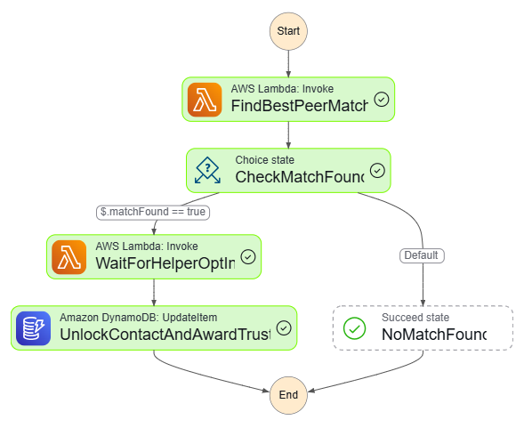

# LivedPath — Serverless Lived-Experience Peer Matching Engine

**LivedPath** connects people navigating major business, career, or life transitions with verified peers who have already walked that exact path—built 100% on serverless AWS services that scale to zero.

## The Problem
When facing high-stakes milestones (launching a startup, transitioning from freelancing to an agency, or navigating career pivots), generic advice falls short. People need guidance from real individuals who have lived through the same experience—without exposing their personal contact information upfront or risking scams from unverified accounts.

## How It Works
1. **Zero-Trust Identity & Privacy Pipeline:** Users upload a government ID and selfie directly to **Amazon S3** via a short-lived presigned URL. **AWS Lambda** invokes **Amazon Rekognition** (`CompareFaces` and `DetectText`) to verify identity, awards an initial `TrustScore` in **Amazon DynamoDB**, and immediately purges the raw ID images from S3 for privacy.
2. **AI Lived-Experience Matching:** Users post a "Need Notice" specifying their challenge and preferred helper age range. **AWS Step Functions** filters verified helpers in **DynamoDB** and invokes **Amazon Bedrock (Claude Haiku 4.5)** to semantically match lived experiences and generate a compatibility explanation.
3. **Double Opt-In Handshake & Rewards:** Step Functions pauses execution at **$0 idle cost** using the `lambda:invoke.waitForTaskToken` callback pattern until the matched peer accepts. Upon acceptance, contact details unlock and the helper earns **+25 Trust Points** in DynamoDB.

## Architecture & Step Functions Execution Flow



```text
[Web Frontend]
     |
     +--> Amazon S3 (Presigned URL) --> Lambda + Amazon Rekognition (CompareFaces + DetectText)
     |                                         +--> Auto-deletes raw Gov ID + updates DynamoDB TrustScore
     |
     +--> Amazon API Gateway --> AWS Lambda --> AWS Step Functions
                                                 +--> Lambda + Amazon Bedrock (Claude Haiku 4.5 Semantic Match)
                                                 +--> Lambda .waitForTaskToken (Pauses at $0 cost for Helper Opt-In)
                                                 +--> DynamoDB UpdateItem (Unlocks contact & awards +25 TrustScore)
```

## Serverless AWS Stack
- **AWS Lambda** — Event-driven Python 3.12 compute for presigned URLs, ID verification, AI matching, and callback handling
- **Amazon API Gateway** — REST API endpoints connecting the frontend to backend workflows
- **AWS Step Functions** — Orchestrates multi-step AI matching and human-in-the-loop match approvals
- **Amazon DynamoDB** — On-demand (`PAY_PER_REQUEST`) single-table storage for verified profiles, notices, and trust ledgers
- **Amazon S3** — Ephemeral ID upload staging (with 24-hour lifecycle expiry)
- **Amazon Rekognition & Amazon Bedrock** — Automated face/ID verification and semantic peer matching
- **AWS SAM** — Reproducible Infrastructure-as-Code deployment

## Deploy It Yourself
```bash
sam build
sam deploy --guided
```
